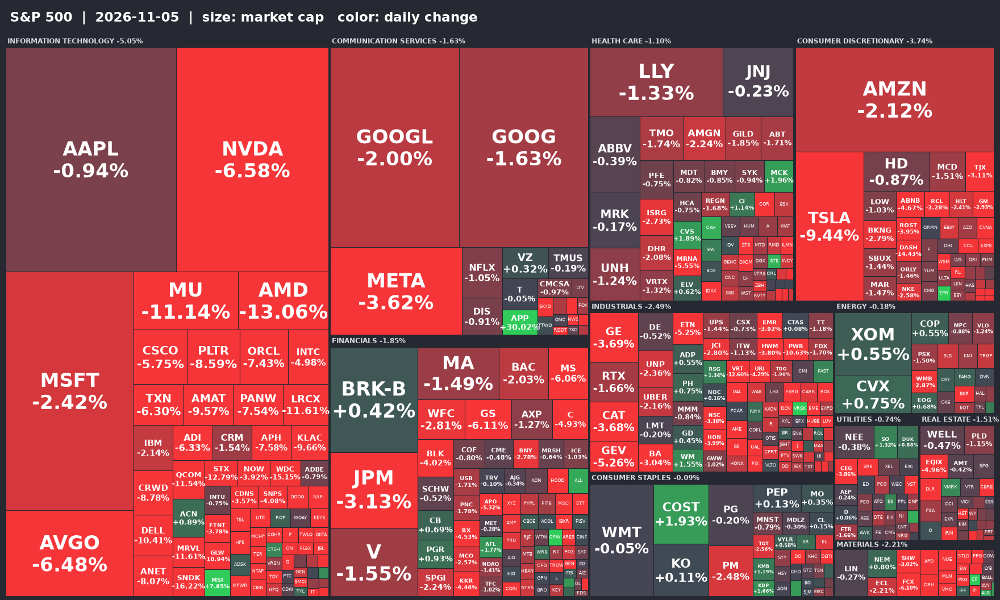

# 美股盤後報告｜美東 2026-11-05（四）

抓取時間：台北 11/06 00:42／美東 11/05 11:42　｜　新聞涵蓋最近 24 小時　｜　時間欄為台北時間

## 一、四大指數

**一句話**：道瓊工業 -2.30%、S&P 500 -2.98%、那斯達克 -4.01%、費城半導體 -8.53%

| 指數 | 代號 | 收盤 | 漲跌 |
|---|---|---|---|
| 道瓊工業 | ^DJI | 52,128.62 | -2.30% |
| S&P 500 | ^GSPC | 7,459.64 | -2.98% |
| 那斯達克 | ^IXIC | 24,705.31 | -4.01% |
| 費城半導體 | ^SOX | 9,392.43 | -8.53% |

- 其他：羅素 2000 2,773.68（-2.91%）、VIX 22.38（+34.74%）
- 資料日期：2026-11-05（Yahoo Finance，約 15 分鐘延遲）

## 二、個股資訊

| 個股 | 收盤 | 漲跌 | 財報 |
|---|---|---|---|
| AAPL | 346.48 | -0.87% | — |
| MSFT | 542.64 | -2.37% | — |
| NVDA | 187.51 | -6.31% | 11/18 |
| AMZN | 260.74 | -1.99% | — |
| GOOGL | 284.08 | -1.68% | — |
| META | 608.16 | -3.47% | — |
| TSLA | 349.71 | -9.21% | — |

### AAPL　-0.87%

- `11/06 00:13` [Micron Sinks 13% as Chip Rout Deepens and $4.5 Billion Taiwan Plant Stalls](https://www.tikr.com/blog/micron-sinks-13-as-chip-rout-deepens-and-4-5-billion-taiwan-plant-stalls?ref=yahoofinance&tlnk=yf-261105-4j94c4wf&.tsrc=rss) — *Yahoo Finance*
  > Key TakeawaysMicron fell 13% on a phone chipmaker’s memory-cost warning and a reported pause at a $4. 5 billion Taiwan plant.
- `11/05 23:28` [Human Augmentation - Global Strategic Business Report: Capitalize on an 18.8% CAGR to Secure the US$716.4 Billion 2030 Market as Apple, Amazon, Cyberdyne and Ekso Bionics Disrupt the Value Chain](https://finance.yahoo.com/technology/ai/articles/human-augmentation-global-strategic-business-152800707.html?.tsrc=rss) — *Yahoo Finance*
  > Target wearables, AI-enabled assistive technologies, and healthcare, industrial and defense applications; use tariff and regional insights to optimize sourcing and uncover revenue…
- `11/05 23:17` [Learn Why The Bull Case For Resideo Technologies (REZI) Could Change Following Apple HomeView Update](https://finance.yahoo.com/markets/stocks/articles/learn-why-bull-case-resideo-151728521.html?.tsrc=rss) — *Yahoo Finance*
  > Resideo Technologies reported that in October 2026 it announced a software update planned for early 2027 that will let existing Honeywell Home ElitePRO, X7S and X8S thermostats sup…
- `11/05 23:09` [Sandisk Sinks 14%, Micron Down 10% as a Top Phone Chipmaker Blames Weak Sales on “Industry-Wide Memory Dynamics”](https://www.tikr.com/blog/sandisk-sinks-14-micron-down-10-as-a-top-phone-chipmaker-blames-weak-sales-on-industry-wide-memory-dynamics?ref=yahoofinance&tlnk=yf-261105-8gc35pvp&.tsrc=rss) — *Yahoo Finance*
  > Key TakeawaysSandisk fell 14% today after a top phone chipmaker said its handset chip revenue dropped 26%, citing memory prices. That report confirms what Sandisk’s own phone and P…
- `11/05 23:08` [SK hynix Sinks 9% as Qualcomm’s 26% Handset Plunge Deepens Memory Chip Rout](https://www.tikr.com/blog/sk-hynix-sinks-9-as-qualcomms-26-handset-plunge-deepens-memory-chip-rout?ref=yahoofinance&tlnk=yf-261105-5324ff3r&.tsrc=rss) — *Yahoo Finance*
  > Key TakeawaysSK hynix shares fell 9% after Qualcomm reported a 26% drop in handset chip sales as memory costs push phone prices up. Conventional DRAM, the kind phones use, drove SK…
- `11/05 23:07` [The Market Landscape Is Shifting–and the AI Trade Looks Lost](https://finance.yahoo.com/m/5cf8d0fd-2174-34c3-a759-e1f37c96b4e1/the-market-landscape-is.html?.tsrc=rss) — *Yahoo Finance*
  > Consumer staples, financials, and healthcare sectors are doing well again. The same can't be said for tech.

### MSFT　-2.37%

- `11/06 00:26` [CoreWeave Sinks 9% as Microsoft Rejects Nscale’s Texas Expansion: “The First Person Who’s Going to Suffer”](https://www.tikr.com/blog/coreweave-sinks-9-as-microsoft-rejects-nscales-texas-expansion-the-first-person-whos-going-to-suffer?ref=yahoofinance&tlnk=yf-261105-xjv67mx4&.tsrc=rss) — *Yahoo Finance*
  > Key TakeawaysCoreWeave fell 9% today after a report that Microsoft passed on an option to more than double its Texas lease with Nscale. Neoclouds borrow against new contracts, so a…
- `11/06 00:21` [IREN stock plunges 18% as Microsoft raises concerns over data center delays](https://finance.yahoo.com/markets/stocks/articles/iren-stock-plunges-18-microsoft-162134051.html?.tsrc=rss) — *Yahoo Finance*
  > Investing.com -- IREN Ltd. shares plunged 18% Thursday amid a broad technology selloff, with a Bloomberg report highlighting growing concerns at Microsoft over delays and execution…
- `11/06 00:13` [Market Chatter: Microsoft Declines Texas Data Center Contract Extension With Nscale, Tightening Data Center Oversight](https://finance.yahoo.com/technology/articles/market-chatter-microsoft-declines-texas-161355924.html?.tsrc=rss) — *Yahoo Finance*
  > Microsoft (MSFT) declined to extend a contract at a Texas data center with Nscale ahead of the start
- `11/06 00:00` ★ [IREN Sinks 20% on Report It’s Behind Microsoft’s AI Spending Delay Ahead of Earnings](https://www.tikr.com/blog/iren-sinks-20-on-report-its-behind-microsofts-ai-spending-delay-ahead-of-earnings?ref=yahoofinance&tlnk=yf-261105-qr7pp429&.tsrc=rss) — *Yahoo Finance*
  > Key TakeawaysIREN is down 20% on a report tying delays at its Childress, Texas, data center to Microsoft’s lower AI spending last quarter. Microsoft’s Childress contract should bri…
- `11/06 00:00` [Scout Clean Energy’s Nimbus Wind Farm Achieves Commercial Operations, Supporting Microsoft’s Clean Energy Portfolio](https://finance.yahoo.com/energy/articles/scout-clean-energy-nimbus-wind-160000329.html?.tsrc=rss) — *Yahoo Finance*
  > 183 MW Wind Facility is Now Largest in the State of ArkansasGREEN FOREST, Ark., Nov. 05, 2026 (GLOBE NEWSWIRE) -- Scout Clean Energy (“Scout”), a leading North American renewable e…
- `11/05 23:58` ★ [Are Big Tech stock buybacks officially dead?](https://finance.yahoo.com/video/are-big-tech-stock-buybacks-officially-dead-155848546.html?.tsrc=rss) — *Yahoo Finance*
  > As hyperscalers Alphabet (GOOGL, GOOG), Amazon (AMZN), Meta (META), and Microsoft (MSFT) pour billions into AI data centers, stock buybacks appear to be taking a back seat. Repurch…

### NVDA　-6.31%

- `11/06 00:33` [Nvidia Is the Biggest Bet in Your Index Fund. Here’s What Its Drop Just Cost You](https://247wallst.com/investing/etf/2026/11/05/nvidia-is-the-biggest-bet-in-your-index-fund-heres-what-its-drop-just-cost-you/?.tsrc=rss) — *Yahoo Finance*
  > One chip stock sank on a morning with no company news, and your 401(k) felt it in three different funds at once. Check how much of your "diversified" portfolio quietly rides on a s…
- `11/06 00:31` [Micron stock declines 12% as chip sell-off deepens](https://finance.yahoo.com/markets/article/micron-declines-12-as-chip-sell-off-deepens-163137019.html?.tsrc=rss) — *Yahoo Finance*
  > Micron led the chip sector lower on Thursday amid a heavy sell-of
- `11/06 00:23` [Chip stocks hammered as political shift raises AI infrastructure concerns](https://www.proactiveinvestors.com/companies/news/1101316/chip-stocks-hammered-as-political-shift-raises-ai-infrastructure-concerns-1101316.html?.tsrc=rss) — *Yahoo Finance*
  > Chip stocks plunged on Thursday, with Nvidia, Micron and AMD leading a sharp selloff that dragged the Nasdaq Composite down nearly 5% as investors reassessed the outlook for AI inf…
- `11/06 00:20` ★ [Greg Abel's 2 Big Acquisitions This Year Cost Berkshire Hathaway About $16 Billion, Less Than 5% of Its Cash Pile](https://www.fool.com/investing/2026/11/05/abels-2-big-acquisitions-this-year-cost-berkshire/?.tsrc=rss) — *Yahoo Finance*
  > Is Greg Abel just getting started, or is this his acquisition approach for the post-Buffett era?
- `11/06 00:15` ★ [What Deutsche Telekom (DTE) Said on Its Q3 Earnings Call](https://www.marketbeat.com/instant-alerts/transcript-what-deutsche-telekom-dte-said-on-its-q3-earnings-call-2026-11-05/?utm_source=yahoofinance&utm_medium=yahoofinance&.tsrc=rss) — *Yahoo Finance*
  > Deutsche Telekom (ETR:DTE) raised its 2026 earnings and cash flow outlook after an increase in guidance from T-Mobile US, while proposing a higher dividend and up to EUR 2 billion…
- `11/06 00:13` [Why Micron Stock Keeps Going Down](https://www.fool.com/investing/2026/11/05/why-micron-stock-keeps-going-down/?.tsrc=rss) — *Yahoo Finance*
  > Micron motored higher as the AI revolution took off. But will competition from China bring it all crashing down?

### AMZN　-1.99%

- `11/06 00:25` [Two Days Before Today's Selloff, Data Put Global September Chip Sales Up 146.8% Year to Year](https://finance.yahoo.com/markets/stocks/articles/two-days-todays-selloff-data-162500958.html?.tsrc=rss) — *Yahoo Finance*
  > Equity Insider News Commentary - Semiconductor stocks are having a hard session. As of 10:34 a.m. ET, the PHLX Semiconductor Index (SOX) stood at 9,419.27, down 8.27% from Wednesda…
- `11/06 00:13` [Amazon Teams Up With Uber Eats, Sending DoorDash Stock Tumbling](https://finance.yahoo.com/m/3bb3616d-c536-39e5-bf6f-a694fc11c77f/amazon-teams-up-with-uber.html?.tsrc=rss) — *Yahoo Finance*
  > DoorDash stock sank after Amazon launched a partnership with Uber to offer restaurant delivery for Prime members.
- `11/06 00:03` [Tesla’s Plunge Just Hit Millions of Index Fund Investors. Here’s How Much Your ETF Lost](https://247wallst.com/investing/etf/2026/11/05/teslas-plunge-just-hit-millions-of-index-fund-investors-heres-how-much-your-etf-lost/?.tsrc=rss) — *Yahoo Finance*
  > You never bought a single Tesla share, yet your retirement account still felt Thursday's selloff. One popular sector fund carries far more exposure than anyone expects, and overlap…
- `11/05 23:58` ★ [Are Big Tech stock buybacks officially dead?](https://finance.yahoo.com/video/are-big-tech-stock-buybacks-officially-dead-155848546.html?.tsrc=rss) — *Yahoo Finance*
  > As hyperscalers Alphabet (GOOGL, GOOG), Amazon (AMZN), Meta (META), and Microsoft (MSFT) pour billions into AI data centers, stock buybacks appear to be taking a back seat. Repurch…
- `11/05 23:44` [Zipline raises $1.5 billion to expand drone delivery](https://www.axios.com/2026/11/05/zipline-walmart-drone-delivery#utm_source=yahoo_finance&utm_medium=partner&utm_campaign=subs-partner-yahoo-finance-AI?.tsrc=rss) — *Yahoo Finance*
  > Zipline, a South San Francisco-based drone delivery service, on Thursday announced that it's raised $1.5 billion at a $21.5 billion post-money valuation. It also expanded its Walma…
- `11/05 23:42` [DoorDash Sinks 13% as Amazon Taps Uber Eats for $0 Prime Restaurant Delivery](https://www.tikr.com/blog/doordash-sinks-13-as-amazon-taps-uber-eats-for-0-prime-restaurant-delivery?ref=yahoofinance&tlnk=yf-261105-w68p7ffg&.tsrc=rss) — *Yahoo Finance*
  > Key TakeawaysDoorDash shares fell 13% today after Amazon and Uber said Prime members now pay a $0 delivery fee on Uber Eats restaurant orders of $25 or more. Prime members have had…

### GOOGL　-1.68%

- `11/06 00:07` [Cipher Digital Sinks Another 21% as AI Data Center Selloff Deepens After Midterms](https://www.tikr.com/blog/cipher-digital-sinks-another-21-as-ai-data-center-selloff-deepens-after-midterms?ref=yahoofinance&tlnk=yf-261105-vm9j3g2h&.tsrc=rss) — *Yahoo Finance*
  > Key TakeawaysCipher Digital fell 21% today as AI data center stocks sold off for a second day after Democrats’ midterm wins. Texas’s governor-elect wants to pause data centers, a b…
- `11/05 23:58` ★ [Are Big Tech stock buybacks officially dead?](https://finance.yahoo.com/video/are-big-tech-stock-buybacks-officially-dead-155848546.html?.tsrc=rss) — *Yahoo Finance*
  > As hyperscalers Alphabet (GOOGL, GOOG), Amazon (AMZN), Meta (META), and Microsoft (MSFT) pour billions into AI data centers, stock buybacks appear to be taking a back seat. Repurch…
- `11/05 23:45` [Meta Has a Capex Guardrail That Few Talk About](https://247wallst.com/investing/2026/11/05/meta-has-a-capex-guardrail-that-few-talk-about/?.tsrc=rss) — *Yahoo Finance*
  > Meta is pouring well over $100B into AI, absorbing a massive legal charge, and watching its stock slide. One overlooked commitment from management gives this investor the nerve to…
- `11/05 23:42` [Anthropic Just Paid a News Publisher for the First Time, and It Was AP](https://247wallst.com/investing/2026/11/05/anthropic-just-paid-a-news-publisher-for-the-first-time-and-it-was-ap/?.tsrc=rss) — *Yahoo Finance*
  > For years, Anthropic bet that fair use covered its training needs while rivals wrote checks. Then Election Night changed the pitch. Is this a one-off for an IPO-bound AI lab, or th…
- `11/05 23:30` [Agentic Commerce Optimization: Adobe Forecasts 130% AI Shopping Traffic Growth; Google Launches Universal Cart](https://finance.yahoo.com/technology/ai/articles/agentic-commerce-optimization-adobe-forecasts-153000869.html?.tsrc=rss) — *Yahoo Finance*
  > Optimum7 today released a guide to agentic commerce optimization, covering the store data AI shopping tools read and the fixes legacy and custom-built ecommerce platforms can need…
- `11/05 23:24` [Midterm Results Put These 4 Renewable, Healthcare & AI Stocks in Focus](https://finance.yahoo.com/markets/stocks/articles/midterm-results-put-4-renewable-152400817.html?.tsrc=rss) — *Yahoo Finance*
  > Midterm election results are reshaping sector sentiment, putting Nextpower, Centene & AI infrastructure companies in focus amid shifting policy expectations.

### META　-3.47%

- `11/05 23:58` ★ [Are Big Tech stock buybacks officially dead?](https://finance.yahoo.com/video/are-big-tech-stock-buybacks-officially-dead-155848546.html?.tsrc=rss) — *Yahoo Finance*
  > As hyperscalers Alphabet (GOOGL, GOOG), Amazon (AMZN), Meta (META), and Microsoft (MSFT) pour billions into AI data centers, stock buybacks appear to be taking a back seat. Repurch…
- `11/05 23:45` [Meta Has a Capex Guardrail That Few Talk About](https://247wallst.com/investing/2026/11/05/meta-has-a-capex-guardrail-that-few-talk-about/?.tsrc=rss) — *Yahoo Finance*
  > Meta is pouring well over $100B into AI, absorbing a massive legal charge, and watching its stock slide. One overlooked commitment from management gives this investor the nerve to…
- `11/05 23:42` [Anthropic Just Paid a News Publisher for the First Time, and It Was AP](https://247wallst.com/investing/2026/11/05/anthropic-just-paid-a-news-publisher-for-the-first-time-and-it-was-ap/?.tsrc=rss) — *Yahoo Finance*
  > For years, Anthropic bet that fair use covered its training needs while rivals wrote checks. Then Election Night changed the pitch. Is this a one-off for an IPO-bound AI lab, or th…
- `11/05 23:04` ★ [AMD CEO Su on earnings outlook, new Starbucks holiday menu, and Hilton CEO on hotel demand](https://finance.yahoo.com/video/amd-ceo-su-on-earnings-outlook-new-starbucks-holiday-menu-and-hilton-ceo-on-hotel-demand-150453106.html?.tsrc=rss) — *Yahoo Finance*
  > Yahoo Finance Executive Editor Brian Sozzi tackles the biggest news of the market day, including AMD's (AMD) earnings outlook topping estimates as chip demand soars, what the blue…
- `11/05 23:04` [Data Center Construction Starts Lag 6 Months Behind, Report Says](https://finance.yahoo.com/m/76a2c085-c8d7-3e24-9b16-f0eb604ab8ef/data-center-construction.html?.tsrc=rss) — *Yahoo Finance*
  > Data center construction starts are slowing, a report from GlobalData finds. Here's why.
- `11/05 23:01` [SpaceX Stock Today Has These 2 Positives. The Stock Is Still Falling.](https://finance.yahoo.com/m/12c89445-f84d-308c-a32e-1b9535c6322f/spacex-stock-today-has-these.html?.tsrc=rss) — *Yahoo Finance*
  > China Renaissance initiates coverage of SpaceX with a Buy rating and a $194.20 price target,

### TSLA　-9.21%

- `11/06 00:03` [Tesla’s Plunge Just Hit Millions of Index Fund Investors. Here’s How Much Your ETF Lost](https://247wallst.com/investing/etf/2026/11/05/teslas-plunge-just-hit-millions-of-index-fund-investors-heres-how-much-your-etf-lost/?.tsrc=rss) — *Yahoo Finance*
  > You never bought a single Tesla share, yet your retirement account still felt Thursday's selloff. One popular sector fund carries far more exposure than anyone expects, and overlap…
- `11/06 00:03` [Prediction: Tesla’s Next Act Could Be Its Most Important Yet](https://247wallst.com/investing/2026/11/05/prediction-teslas-next-act-could-be-its-most-important-yet/?.tsrc=rss) — *Yahoo Finance*
  > Tesla is trading near its highest valuation in years while earnings are under serious pressure, and the gap between what the stock promises and what it delivers right now has never…
- `11/05 23:34` [BC-Most Active Stocks](https://finance.yahoo.com/markets/stocks/articles/bc-most-active-stocks-153422188.html?.tsrc=rss) — *Yahoo Finance*
  > NEW YORK (AP) — prices for the Nasdaq composite, NYSE and NYSE American listed most active stocks. Nasdaq most active stocks:Stock Name Volume High Low Last Change Lakewood Amedex…
- `11/05 23:30` ★ [SpaceX, Tesla stocks tumble as Democratic sweep raises questions on merger prospects, AI build-out](https://finance.yahoo.com/markets/article/spacex-tesla-stocks-tumble-as-democratic-sweep-raises-questions-on-merger-prospects-ai-buildout-153753814.html?.tsrc=rss) — *Yahoo Finance*
  > SpaceX and Tesla extended declines on Thursday.
- `11/05 23:07` [Elon Musk faces a new $28.5 trillion problem after Texas upset](https://finance.yahoo.com/technology/ai/articles/elon-musk-faces-28-5-150747509.html?.tsrc=rss) — *Yahoo Finance*
  > Democratic victories could bring greater scrutiny of Elon Musk's companies, government contracts and planned data-center projects.
- `11/05 23:04` [SpaceX and Tesla stocks extend their slide as chip stocks drop: AlphaCheck](https://finance.yahoo.com/markets/article/spacex-tesla-shares-extend-declines-semiconductor-stocks-drop-alphacheck-150427180.html?.tsrc=rss) — *Yahoo Finance*
  > Stocks bounced on Wednesday after Democrats' sweeping mid-term elections.

## 三、市場焦點新聞

### ★ 重點（標題含關鍵字）

- `11/06 00:34` ★ [Bank of Nova Scotia stock drops more than 2% after Federal Reserve approval for MapleMark acquisition](https://news.google.com/rss/articles/CBMihgFBVV95cUxQTnNsZnZyZThwVjA3cjhzZDJaYzI3bC1CU2FfWVp2cVFjTXJXb2NpT01FVGdBWDdHZFhEbmt4WW1IeDRfUGdJWkV4NWNkdWpRcGl5VmdhZlJFSlZqR213NWlHOGNGczBhYnBZcjhsbEc1VWhyNzJGdTRsOE9nY3lfenBldjlZZw?oc=5) — *Google News / Traders Union*
- `11/06 00:34` ★ [Barkin sees interest rate hikes ahead, but at a gradual pace](https://www.cnbc.com/2026/11/05/barkin-sees-interest-rate-hikes-ahead-but-at-a-gradual-pace.html) — *CNBC Top News*
  > In a CNBC interview, the policymaker expressed concern over inflation and said monetary policy will need to adjust.
- `11/06 00:01` ★ [Bank of England hikes interest rate for the first time since Iran war, warns inflation will near 5%](https://www.cnbc.com/2026/11/05/interest-rates-inflation-uk.html) — *CNBC Top News*
  > One policymaker voted to raise the bank's key interest rate to 4.25%.

### 其他市場新聞

- `11/06 00:31` [Democrats to probe JPMorgan's relationship with Jeffrey Epstein when they take Senate control](https://www.cnbc.com/2026/11/05/jpmorgan-epstein-democrats-erdoes-midterm-election.html) — *CNBC Top News*
  > JPMorgan kept Jeffrey Epstein as a client for years after top executive Mary Erdoes hearing claims he paid to have underage girls brought to his home.
- `11/06 00:30` [Why Qualcomm (QCOM) shares are sliding today](https://news.google.com/rss/articles/CBMiqgFBVV95cUxNMUFsMHM4WTR4X1ljUVlWQ1I1NnhJSkRwVHVRUkg3ZmU2bnB0WThCc29tY2ptNDFHNTg5Y2pFMmxsZ28zTmduQ2lTSlR5RFpKbktkTFVsRkpuUFh6YnoydVMwWi1UVm10aUg2cl9qR1NYTUxOcWtBZWF6ZGFIeFBrM0lqdjVjUmFtcWVaLXpaLUdvM0NqWHhLT3RuMTN0V0hjZkFYLUtfSVFoZw?oc=5) — *Google News / StockStory*
- `11/06 00:28` [Why Purple (PRPL) stock is down today](https://news.google.com/rss/articles/CBMingFBVV95cUxQalF4LUw1YV9OdmRQWlZWZW9vZGJ4WkhUSDNKOGV2ak95TzBzV1c3SkNXWllTQUhBRkd6SFpiMHhhYTVTdTVHUHk4RVNyUEQwT1hoek5HenlmbldYcXk3SHlUaEVDaUZYc2kyMXFVTjlCMU9LY3IyY1ZkUUYwX282MFRnRkpxbDZ3TjNvQzh0aklGejEzUzFGRlNSOEY3UQ?oc=5) — *Google News / StockStory*
- `11/06 00:27` [Coinbase Stock And 2 Crypto Growth Shares Worth A Closer Look](https://news.google.com/rss/articles/CBMizgFBVV95cUxOXzJTbzlPSHMxeHA0SWRoeWZBcjh5S0p4X2t3NW54TW9FMmpnTmw4bzBZU3FYdEpIcW4zcUZ6RHNYeVhCbW0yc19NS0s5Tnh0NHpqbkZhODRZQ2NoOHFLUm1NWVU3NTgwMXotYzJrTzRjcmV1Q0RyNDk0Y0RtUzI1TXJFNEtwRlFRYmFkNzJVOFdVSXZjeDk5czFhNVN5QTVRSDVaOHU1TEN3RXR3NHRLV195dXZBQi05elVwdjB1Vm9kT0lHZ0JiNjBfT1ViUdIB0wFBVV95cUxOOEFIQ29IREdlakNYeFdkMUlLdUhfbmZyd1VENk5XTlFaTTZIdWxZNGM0Q0U1ekRMMlFiYnRqM3ZDY05fU0JjRFJOQVNtR2V2Y1FseHRodHZwQ195LTFIVmRDTTFueGdIUmJNaGVYU2VyaTN4STFWOUNwQkVJRXZQZWNWRF81ei1pcDdfeXlXLXowd05KdnhLYXNWeTg3SEF6eFN5MUJtY1VKWjBaandabm1jVkpyYWp0Znd2MmNxN054YmtITGVqSnVrZ2tOc1A2N3Bv?oc=5) — *Google News / Simply Wall St*
- `11/06 00:27` [Marc Lore's Wonder confidentially files for IPO](https://www.cnbc.com/2026/11/05/wonder-confidential-ipo-filing.html) — *CNBC Top News*
  > Marc Lore's latest startup Wonder has confidentially filed for an initial public offering.
- `11/06 00:23` [Trump's energy deals are about to face a wave of investigations by Democrats](https://www.cnbc.com/2026/11/05/trump-election-energy-venezuela-critical-mineral-renewable-iran.html) — *CNBC Top News*
  > Democrats are certain to scrutinize the U.S. intervention in Venezuela, administration mineral deals and the cancellation of previously funded energy projects.
- `11/06 00:23` [The year’s most successful stock-market trades are unraveling — perhaps for good](https://www.marketwatch.com/story/the-years-most-successful-stock-market-trades-are-unraveling-perhaps-for-good-45f7a0dd?mod=mw_rss_topstories) — *MarketWatch Top Stories*
  > Wall Street’s top trades of 2026 are coming undone as a violent rotation rattles the U.S. stock market.
- `11/06 00:22` [We're booking big profits in 2 outperformers in Thursday's terrible market](https://www.cnbc.com/investingclub/2026/11/05/were-booking-big-profits-in-2-outperformers-in-thursdays-terrible-market.html) — *CNBC Top News*
  > They have nothing to do with tech and data centers, which are getting slaughtered.
- `11/06 00:20` [Stock Market Today: Nasdaq Sinks 5% as AI Selloff Hits Chip and Data-Center Stocks, Oil price at $96](https://news.google.com/rss/articles/CBMiwgFBVV95cUxPVzFHdnZnOW5MTzJLa1Ryc20wVlZvcjVYR1pjSmFGaTY3dnVaUHkzVGVuSmc2N1ZreTBvMGtybmVCSHM5Slg4SGJfNHQ5My04WTBRZldCaGlaYVV5clU0S3hqeWNKTEotSldOR3prZmxwM0dEcm1MdUF5LW04T0FxR1pYTFJHcHRzSjJPTWpqazZmRTRsRlZWcXljSThjcVhUX3hLWkZCZVNCT2dXc0J0Rmd4Tzh0YUk1MkhwV3hpZzlQZw?oc=5) — *Google News / Eurasia Business News*
- `11/06 00:17` [Why Is the US Stock Market Crashing? 3 Reasons Behind the $2 Trillion Wipeout](https://news.google.com/rss/articles/CBMib0FVX3lxTE5vdnhEcGxtZGxXek5BMkZYeV9ZcWZVN09CY05VczM3NUQ4Skh1eHQ2SW5fX0VoUzJGOXk4RzdzS0wwQ25NTXVsRzhqaWEwcktUMU1NSnh4cjliYmNJWENoZnpZWkhLYW92NklRS0hwMA?oc=5) — *Google News / BeInCrypto*
- `11/06 00:15` [A record number of first-time home buyers now pay in cash. Here’s where they get the money.](https://www.marketwatch.com/story/a-record-10-of-first-time-home-buyers-now-pay-in-cash-heres-where-they-get-the-money-70f2e656?mod=mw_rss_topstories) — *MarketWatch Top Stories*
  > All-cash buyers are becoming more common, despite a housing market that’s been struggling with affordability issues.
- `11/06 00:14` [Why is Texas Instruments stock sliding today?](https://news.google.com/rss/articles/CBMiqgFBVV95cUxNd0N6Ymg2OGM1WjlmUFVnY0hWMjM0YXdnMFAwMzJXWERNUDNmcmRSMUlNQ18wSFFDOUVhSW42WW10b21zaGVmVzJhRC1oMzlaLUJGT3plUGNuNXhJS0xTQkxaWWgtTkxsYzdXUE1jcTNwbkxMSmdjNVZXNEhkSVZFTWpfVFk4NmZiRHBZNGxwbjRxUTk0T0N0UnJwc0VXTU9tWEVfN0JST2Jpdw?oc=5) — *Google News / Investing.com*
- `11/06 00:13` [Nasdaq 100 Falls 4% as Chipmaker Selloff Deepens: Markets Wrap](https://news.google.com/rss/articles/CBMilAFBVV95cUxPaHBnOEludEdwalhTMXRiLWFQbk9RRVVIVGYzY3cwZUk4TmxLY1hnZExZQTZBTExfR2l2TmpJNXUwRWUwc21Jd0EzZklqc2hCbnRta19OU1lQV2NTdjhuNUZxaGQwaHlBZG51eG44WXFxNTNuX1FRYVluOGdaTFptSWRFY3J1ZTdMTlFzY3VmYVhkbDJH?oc=5) — *Google News / Bloomberg.com*
- `11/06 00:12` [This pancreatic cancer treatment is on track for ‘one of the best drug launches of all time’](https://www.marketwatch.com/story/this-pancreatic-cancer-treatment-is-on-track-for-one-of-the-best-drug-launches-of-all-time-37bf86ce?mod=mw_rss_topstories) — *MarketWatch Top Stories*
  > Revolution Medicines’ brand-new treatment brought in far higher sales than expected in its first few weeks on the market.
- `11/06 00:09` [Why is Broadcom stock tumbling today?](https://news.google.com/rss/articles/CBMinwFBVV95cUxNcHJEX2gxTFJVUlA3U25DX3VERXp3RkRJcXVORTVqc2UyQ2ZKUE5SejM2U05YTWF0cjZnd0ltWllsbDJ4cldOZnltYTE5bVo2ZjlRbno0bHBiNU9nU2ZMbVA3SnVwV2YzN0F0dDFlWkZhUW5FYWVrZ2xGRE5oakdETER4SDhjTG9oN0ZaQWdIWHcwTFdhbW9lMVR6VW9IRnc?oc=5) — *Google News / Investing.com*
- `11/06 00:08` [AI Stocks Fall Again, Wiping Out Nvidia’s Whole Gain for the Year](https://news.google.com/rss/articles/CBMimAFBVV95cUxPYTNxOTJFZ042NkZ6WWVsaXVOa2kxdWtteS1MelB4cDU1UTg4V0VOcWc3Nk1hNFdERTBERERVZUozRmpfSVl6b0oyZ01oODVEQmRkeXV5Mm1kalFWcmpkV2s5RFpodldGVXZMZmc3QmFjYlNMMGpwbzJQUFRmZHM0cDJQOFZSMmsxMXpKcTJfR1M3WWtycjZGcg?oc=5) — *Google News / Stock Titan*
- `11/06 00:07` [Voters say the economy drove them to the polls — and blame Trump for their troubles](https://www.cnbc.com/2026/11/04/2026-midterms-trump-economy-iran-war.html) — *CNBC Top News*
  > Participants in the CNBC Voter Poll ranked the economy the most important issue facing the country, ahead of topics tied to democracy and immigration.
- `11/06 00:06` [Micron, Sandisk and other AI stocks are falling hard: ‘Investors don’t like uncertainty.’](https://www.marketwatch.com/story/micron-sandisk-and-other-ai-stocks-are-falling-hard-investors-dont-like-uncertainty-94d2a3b9?mod=mw_rss_topstories) — *MarketWatch Top Stories*
  > Wall Street is digesting the prospect of a slower AI buildout in the wake of the midterm-election results.
- `11/06 00:05` [SpaceX Lessors Look To Sell $40 Bil AI Deal. ARK Buys The Dip On SPCX Stock.](https://news.google.com/rss/articles/CBMiwAFBVV95cUxNWGJXUGZWcjh1MWNNeFNGZmRPTHF6bVBzOGx5NHFVQlVOUnFFMVZLbEV3Ul93cF9yUElSUUNVd1NhektWMU5VcEdCUmhJQms5dGxZRlBwSFRPODBIRXVLWV96QTg2VklRTk96QlpZNXZpTF9Vck05SjlxSnliVjFPcDFrTDk4OHF4Sk92b09LX1RZVjZ3d2ZVOVdYc1dIV1lxLXBEbDBydjVaVUR4VXZ1cHZQWVVjTmoydU5KeU9nZHE?oc=5) — *Google News / Investor's Business Daily*
- `11/06 00:00` [An Anthropic IPO when the AI trade is this turbulent? Goodspeed!](https://www.marketwatch.com/story/an-anthropic-ipo-when-the-ai-trade-is-this-turbulent-godspeed-08ca0496?mod=mw_rss_topstories) — *MarketWatch Top Stories*
  > Wall Street takes a harder look at AI costs after historic midterm results. Plus, the upside to Apple’s lack of artificial-intelligence spending.
- `11/05 23:56` [A wipeout for AI stocks sends Wall Street tumbling, and the S&P 500 drops more than 3%](https://news.google.com/rss/articles/CBMiggJBVV95cUxQbDFQMkNWeWZsNlR4dFNNM0FxX0t4eFBfblNrZkRGa3hwcVFQUnlwUXZfaXNaN1RHVjNRd1BMVTlobl94REhMQjk3emlyXzhsQXRxWHJqWkU2blFKYmhUaDhuUk9ib1RmUnBqQVJhUzRySTRHc3NiSnR1bndWVThMTHFLRGpDc1h5R1JCaHN5UUxUaVpSN1JhMmppWkM4RkNjTV9VbV9VM0d0MmhLWkwzaFpSMmV5NGkwYmYzd05HVWhZanRweEJ1S1NBVVY0dUZpMUN1TVJsWkpGQTNNYm1iSHloSF9TU1VRWkRtZTdjT1hNWGZHRUpZb3dDUl9ObWNhUFE?oc=5) — *Google News / LancasterOnline*
- `11/05 23:54` [Is the US exorbitant privilege eroding?](https://news.google.com/rss/articles/CBMif0FVX3lxTFBpYzRyV2l0cERMX1FGUzNlel96WUVKSHRnWDN1cnM3dU9zM2pCMDU3OXNaZlJlSmlkNEU3UUQxNU5MUUpYaFhsVHBrZGNnVHZ1RWkyMWtNRHNYTE9GdnQ0MTgwakVPUEJkcE5RamE0M1JvNnhPeHlDMUx2QUphWHc?oc=5) — *Google News / Brookings*
- `11/05 23:50` [Why is CoreWeave stock sliding today?](https://news.google.com/rss/articles/CBMinwFBVV95cUxQUmM0alQ4Nmg0TTBhblNUcmlJcUNGcGNrMTFJN2dlY3hYbUZZUlhIOHV6eHU0NkNaNEdvdjVRcjVqSU50OWZZNU5PdW5yWGd3N2lVNngyaGpYQnV4ZktNVTVMMnNodjVTM1otWmVJTFRqaWFIUC1ycmw2ZE56blhzRzNCTmRVbl9wUEllRkpVdHVrOEE1aV9zTzh5VHFGMGs?oc=5) — *Google News / Investing.com*
- `11/05 23:50` [Why is Palantir Technologies stock plummeting today?](https://news.google.com/rss/articles/CBMiswFBVV95cUxPTElqSUxzU2ZRTXo5cHZTZzdqeUE4Zk92YjhlUHVLcUQ0bXhSM1VJMXc5RU5RYm5tU3NPY3Y3QllnczlpU2lLMjNQckR1UDVYVk5rOTBiN3lBXzNDVTQyZG9pZjMzdldpZGFpNl9PQ0FJOXRkeTJhNU5iU09vRHNSdjZjSl9XazdKWHUxVndhSU5jUHdjYThtQWM4R2hOcFRyWWhLTzl3VFJfWVhQMk0yRUU0MA?oc=5) — *Google News / Investing.com*
- `11/05 23:50` [Why is Keel Infrastructure stock collapsing today?](https://news.google.com/rss/articles/CBMisAFBVV95cUxQeFVwSGhlLXRIMzhvSnRLYkpWd2ZlREVfWERWZ0tlXy1CSkRlRnNIa0dBSnpTTHJoaWR3S3N1S3l0Y3hTYUJqdnE3U3N2Y2MwS3lfOGZIdWRMd19kdDdJdldEOWxQR2lIa0c3RTU0ZWFib29JVnJWOXRLS0k2X1R5UFZhM0FEYzBlMmdFeEhJdUZDaWlTQ0NqTUZVN1Y0Yl84emdrWW9UOURybGg1cDA4Rg?oc=5) — *Google News / Investing.com*
- `11/05 23:46` [These Boeing Directors Just Bought Shares. Here’s What Wall Street Thinks.](https://news.google.com/rss/articles/CBMitgFBVV95cUxNeXFreWxVbml0VHAxcWp4SEk0V2h3WGtlTjZQbE02bXlDVTFmcG1yZGs5V2c3OGVRcGlFeTVDM1k3TkozbTktM1RWamJWZDI5LWh0MDdoNEw0S2p1VVFMMXdMcXN5VnlPREROZ3NWWWw0dnJ4aTFVVUZBeHBlZkVxVXNNb0h0RWozSXlXNEFhZVMwM1V3RURyanNNcEdESlM3WFJDRVROd2dLR2dTZUVSS0Fpem1RQQ?oc=5) — *Google News / 24/7 Wall St.*
- `11/05 23:43` [Netanyahu's position weakens as rival secures broad backing to try to form government - Reuters](https://news.google.com/rss/articles/CBMivAFBVV95cUxONXl2TW1pRDd2eEFya2FTU0pkOWJWd3lFZG1PdUdSNlBWTVR5VGp3UWtLb2E0Ri1iTmt1SWhRckdOVVhkN2ItZ1Y2QlhjT2NrcGR0ZTg3MklhcENpZUFOM0I1SDRYdTZwMFlYeGMwMTM1SWF5ZzNnd2h4ZnJ1bC1BZWhlNDlYUXM3S3FRdXVyR1p3SE5GYUFoMm1wSWRYSlBYY3NkcTBpVklrTnZibm51eURCWkszdHBtdU9vYQ?oc=5) — *Finnhub / Reuters*

## 四、S&P 500 熱力圖

- 上漲 92 檔、下跌 411 檔（共 503 檔）｜市值加權漲跌 -2.85%
- 推升指數最多：APP +30.02%、COST +1.93%、MSI +7.85%、BRK-B +0.42%、XOM +0.55%
- 拖累指數最多：NVDA -6.58%、TSLA -9.44%、MSFT -2.42%、AVGO -6.48%、AMD -13.06%
- 方塊大小為市值（股價 × 流通股數，近似值），顏色為當日漲跌，綠漲紅跌，±3% 為最深色

## 五、類股表現

- 最強：能源 -0.19%｜最弱：科技 -5.68%

| 類股（SPDR ETF） | 代號 | 收盤 | 漲跌 |
|---|---|---|---|
| 能源 | XLE | 63.40 | -0.19% |
| 必需消費 | XLP | 91.67 | -0.29% |
| 通訊服務 | XLC | 104.36 | -0.57% |
| 公用事業 | XLU | 43.28 | -0.76% |
| 醫療保健 | XLV | 187.51 | -1.13% |
| 房地產 | XLRE | 44.37 | -1.66% |
| 金融 | XLF | 58.01 | -2.02% |
| 原物料 | XLB | 52.60 | -2.42% |
| 工業 | XLI | 165.07 | -2.59% |
| 非必需消費 | XLY | 117.86 | -3.66% |
| 科技 | XLK | 166.48 | -5.68% |

## 六、漲跌排行

### 漲幅排行

| 代號 | 名稱 | 價格 | 漲跌 | 市值 |
|---|---|---|---|---|
| APP | Applovin Corporation | 354.52 | +30.46% | 119.1B |
| ADMA | ADMA Biologics Inc | 13.20 | +25.95% | 3.0B |
| XERS | Xeris Biopharma Holdings, In… | 13.08 | +25.05% | 2.4B |
| WRBY | Warby Parker Inc. | 26.63 | +25.08% | 3.3B |
| MGNI | Magnite, Inc. | 27.70 | +21.54% | 4.0B |
| SEZL | Sezzle Inc. | 162.53 | +18.90% | 5.5B |
| ARDT | Ardent Health, Inc. | 15.22 | +17.17% | 2.1B |
| ECPG | Encore Capital Group Inc | 117.11 | +17.20% | 2.5B |
| EPAM | EPAM Systems, Inc. | 160.11 | +16.56% | 8.3B |
| U | Unity Software Inc. | 48.29 | +13.72% | 21.3B |

### 跌幅排行

| 代號 | 名稱 | 價格 | 漲跌 | 市值 |
|---|---|---|---|---|
| FSLY | Fastly, Inc. | 16.20 | -22.99% | 2.6B |
| GIL | Gildan Activewear, Inc. | 33.38 | -22.86% | 6.2B |
| ROAD | Construction Partners, Inc. | 77.89 | -21.51% | 4.4B |
| RELY | Remitly Global, Inc. | 21.39 | -20.99% | 4.5B |
| ARQT | Arcutis Biotherapeutics, Inc… | 27.00 | -20.69% | 3.4B |
| BROS | Dutch Bros Inc. | 35.30 | -19.74% | 6.2B |
| CAI | Caris Life Sciences, Inc. | 26.77 | -19.43% | 7.6B |
| LGN | Legence Corp. | 26.15 | -18.61% | 4.3B |
| DAVE | Dave Inc. | 274.80 | -18.27% | 3.5B |
| AXTI | AXT Inc | 39.01 | -17.94% | 2.6B |

### 成交最活躍

| 代號 | 名稱 | 價格 | 漲跌 | 市值 |
|---|---|---|---|---|
| NVDA | NVIDIA Corporation | 187.43 | -6.35% | 4,525.9B |
| INTC | Intel Corporation | 55.63 | -4.52% | 295.7B |
| SPCX | Space Exploration Technologi… | 125.31 | -7.80% | 1,701.9B |
| KVUE | Kenvue Inc. | 19.31 | -1.28% | 37.1B |
| IREN | IREN LIMITED | 18.59 | -14.37% | 7.5B |
| NOK | Nokia Corporation Sponsored | 7.62 | -7.69% | 42.7B |
| GRAB | Grab Holdings Limited | 3.37 | +0.15% | 13.6B |
| CRWV | CoreWeave, Inc. | 43.50 | -10.16% | 24.0B |
| WULF | TeraWulf Inc. | 10.29 | -12.00% | 5.1B |
| SNAP | Snap Inc. | 5.07 | -14.44% | 8.6B |
> Yahoo Finance 預設篩選條件。

## 七、債市、匯市與商品

### 美國公債殖利率（財政部）

資料日期：2026-11-04（與 11/03 比較）

| 天期 | 殖利率 % | 日變動 |
|---|---|---|
| 1 Mo | 4.01 | -2 bp |
| 3 Mo | 4.21 | +0 bp |
| 6 Mo | 4.25 | -1 bp |
| 1 Yr | 4.39 | -1 bp |
| 2 Yr | 4.58 | -3 bp |
| 5 Yr | 4.69 | -5 bp |
| 10 Yr | 4.90 | -5 bp |
| 20 Yr | 5.30 | -5 bp |
| 30 Yr | 5.28 | -4 bp |

- 10 年 − 2 年利差：+32 bp（前一日 +34 bp）
- 財政部當日數據尚未公布，以上為前一交易日；即時殖利率見下表。

### 即時利率、美元與商品（Yahoo Finance）

| 項目 | 代號 | 收盤 | 漲跌 |
|---|---|---|---|
| 美債 10 年殖利率 % | ^TNX | 4.85 | -4.7 bp |
| 美債 13 週殖利率 % | ^IRX | 4.01 | -1.7 bp |
| 美元指數 | DX-Y.NYB | 101.54 | +0.02% |
| WTI 原油 | CL=F | 90.68 | +2.91% |
| 黃金 | GC=F | 4,120.30 | +1.16% |
| 比特幣 | BTC-USD | 76,606.99 | -4.72% |

## 八、經濟數據與聯準會

### 重要指標（FRED）

| 項目 | 代號 | 最新 | 變動 | 資料日期 |
|---|---|---|---|---|
| 聯邦基金有效利率 % | DFF | 3.88 | +0.00 | 2026-11-03 |
| 10Y−2Y 利差 % | T10Y2Y | 0.32 | -0.02 | 2026-11-04 |
| 10 年期損益兩平通膨 % | T10YIE | 2.26 | -0.04 | 2026-11-04 |
| 高收益債利差 % | BAMLH0A0HYM2 | 3.32 | -0.08 | 2026-11-04 |
| CPI 年增率 %（月） | CPIAUCSL | 4.02 | +0.31 | 2026-09-01 |
| 失業率 %（月） | UNRATE | 4.20 | +0.10 | 2026-09-01 |
| 非農就業人數（千人，月） | PAYEMS | 159,044.00 | +29.00 | 2026-09-01 |

### 未來 7 天經濟數據（美東日期）

| 日期 | 發布項目 |
|---|---|
| 2026-11-05 | FOMC Press Release |
| 2026-11-05 | Unemployment Insurance Weekly Claims Report |
| 2026-11-06 | Chicago Fed Advance Retail Trade Summary |
| 2026-11-06 | Employment Situation |
| 2026-11-06 | FOMC Press Release |
| 2026-11-06 | State Unemployment Insurance Weekly Claims Report |
| 2026-11-07 | FOMC Press Release |
| 2026-11-08 | FOMC Press Release |
| 2026-11-09 | FOMC Press Release |
| 2026-11-10 | Consumer Price Index |
| 2026-11-10 | Consumer Price Index Excluding Energy Commodities |
| 2026-11-10 | FOMC Press Release |
| 2026-11-10 | Research Consumer Price Index |
| 2026-11-11 | FOMC Press Release |
| 2026-11-12 | Existing Home Sales |
| 2026-11-12 | FOMC Press Release |
| 2026-11-12 | Unemployment Insurance Weekly Claims Report |

> 預期值與公布值請對照 Investing.com 經濟日曆。

### 聯準會公告

- `11/06 00:00` [Federal Reserve Board announces termination of enforcement action with Allegiant United Holdings, LLC, Nano Financial Holdings, Inc., and Nano Banc](https://www.federalreserve.gov/newsevents/pressreleases/enforcement20261105a.htm) — *Federal Reserve*

## 九、財報行事曆

### 今日（美東 11/05）

| 代號 | 時段 | EPS 實際 | EPS 預估 | 營收實際 | 營收預估 |
|---|---|---|---|---|---|
| CI | 盤前 | 7.98 | 7.73 | 73.79B | 74.90B |
| CAH | 盤前 | 3.26 | 2.97 | 67.51B | 67.25B |
| COP | 盤前 | 3.27 | 2.99 | 20.06B | 18.36B |
| USFD | 盤前 | 1.26 | 1.27 | 10.40B | 10.81B |
| ARW | 盤前 | 6.22 | 5.01 | 10.72B | 10.11B |
| CMI | 盤前 | 7.71 | 8.28 | 9.44B | 9.95B |
| LYV | 盤後 | — | 1.56 | — | 9.69B |
| DUK | 盤前 | 1.99 | 1.88 | 9.10B | 9.00B |
| SO | 盤前 | 1.94 | 1.76 | 8.84B | 8.61B |
| EOG | 盤後 | — | 4.50 | — | 7.47B |
| DVN | 盤後 | — | 1.34 | — | 7.04B |
| RGA | 盤後 | — | 6.98 | — | 6.75B |
| PH | 盤前 | 8.90 | 8.43 | 5.99B | 5.91B |
| BDX | 盤前 | 4.15 | 4.11 | 5.27B | 5.16B |
| LNC | 盤前 | 1.72 | 1.98 | 5.06B | 5.00B |

### 下一交易日（11/06）預告

| 代號 | 時段 | EPS 預估 | 營收預估 |
|---|---|---|---|
| HUM | 盤前 | -1.01 | 41.30B |
| CHTR | 盤前 | 9.24 | 15.08B |
| PAGP | 盤前 | 0.43 | 15.04B |
| GLP | 盤前 | 1.63 | 7.49B |
| VST | 盤前 | 2.99 | 6.08B |
| FLR | 盤前 | 0.81 | 4.21B |
| DK | 盤前 | 8.06 | 4.04B |
| DCH | 盤前 | 0.19 | 2.82B |
| PPL | 盤前 | 0.54 | 2.44B |
| BIP | 盤前 | 0.22 | 2.22B |
| BEN | 盤前 | 0.78 | 1.88B |
| BAM | 盤前 | 0.47 | 1.59B |
| CLMT | 盤前 | 1.68 | 1.37B |
| VEON | 盤前 | 1.75 | 1.33B |
| UAA | 盤前 | -0.01 | 1.24B |

> ★ 為自選股；盤後公布的財報，實際數字可能稍晚才更新。

## 十、市場情緒

### CNN 恐懼與貪婪指數

| 時間 | 分數（0–100） | 狀態 |
|---|---|---|
| 目前 | 23 | 極度恐懼 |
| 前一日 | 27 | 恐懼 |
| 一週前 | 31 | 恐懼 |
| 一個月前 | 43 | 恐懼 |
| 一年前 | 23 | 極度恐懼 |

- CNN 更新時間：台北 11/06 00:41
- VIX：22.38（+34.74%）

## 十一、資料來源狀況

| 來源 | 筆數 | 時間範圍內 | 狀態 |
|---|---|---|---|
| CNBC Top News | 30 | 30 | ✅ |
| CNBC Earnings | 30 | 13 | ✅ |
| CNBC Economy | 30 | 4 | ✅ |
| MarketWatch Top Stories | 10 | 10 | ✅ |
| MarketWatch MarketPulse | 30 | 0 | ✅ |
| Finnhub 大盤新聞 | 100 | 50 | ✅ |
| Google News「stock market today」 | 100 | 100 | ✅ |
| Google News「Wall Street stocks close」 | 26 | 26 | ✅ |
| Google News「Federal Reserve」 | 50 | 50 | ✅ |
| Google News「Treasury yields」 | 75 | 75 | ✅ |
| Yahoo Finance AAPL | 19 | 19 | ✅ |
| Finnhub AAPL | 177 | 100 | ✅ |
| SEC 8-K AAPL | 10 | 0 | ✅ |
| Yahoo Finance MSFT | 20 | 20 | ✅ |
| Finnhub MSFT | 205 | 121 | ✅ |
| SEC 8-K MSFT | 10 | 2 | ✅ |
| Yahoo Finance NVDA | 17 | 17 | ✅ |
| Finnhub NVDA | 247 | 182 | ✅ |
| SEC 8-K NVDA | 10 | 0 | ✅ |
| Yahoo Finance AMZN | 18 | 18 | ✅ |
| Finnhub AMZN | 205 | 119 | ✅ |
| SEC 8-K AMZN | 10 | 0 | ✅ |
| Yahoo Finance GOOGL | 19 | 19 | ✅ |
| Finnhub GOOGL | 207 | 116 | ✅ |
| SEC 8-K GOOGL | 10 | 0 | ✅ |
| Yahoo Finance META | 17 | 17 | ✅ |
| Finnhub META | 124 | 81 | ✅ |
| SEC 8-K META | 10 | 0 | ✅ |
| Yahoo Finance TSLA | 17 | 17 | ✅ |
| Finnhub TSLA | 143 | 65 | ✅ |
| SEC 8-K TSLA | 10 | 0 | ✅ |
| Federal Reserve | 20 | 1 | ✅ |
| Yahoo Finance 行情 | 30 | — | ✅ |
| Yahoo 排行 day_gainers | 10 | — | ✅ |
| Yahoo 排行 day_losers | 10 | — | ✅ |
| Yahoo 排行 most_actives | 10 | — | ✅ |
| 財政部殖利率曲線 | 212 | — | ✅ |
| FRED DFF | 499 | — | ✅ |
| FRED T10Y2Y | 344 | — | ✅ |
| FRED T10YIE | 344 | — | ✅ |
| FRED BAMLH0A0HYM2 | 361 | — | ✅ |
| FRED CPIAUCSL | 15 | — | ✅ |
| FRED UNRATE | 15 | — | ✅ |
| FRED PAYEMS | 16 | — | ✅ |
| FRED 經濟數據行事曆 | 17 | — | ✅ |
| Finnhub 今日財報 | 561 | — | ✅ |
| Finnhub 下一交易日財報 | 65 | — | ✅ |
| yfinance 自選股財報日 | 1 | — | ✅ |
| CNN 恐懼與貪婪指數 | 1 | — | ✅ |
| S&P 500 成分股行情 | 503 | — | ✅ |
