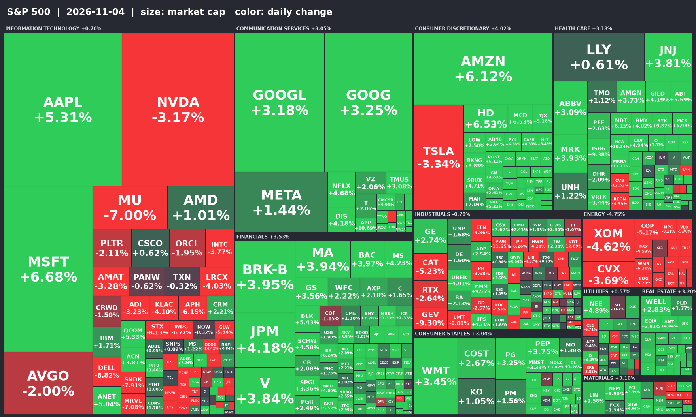

# 美股盤後報告｜美東 2026-11-05（四）

抓取時間：台北 11/06 10:06／美東 11/05 21:06　｜　新聞涵蓋最近 24 小時　｜　時間欄為台北時間

## 一、四大指數

| 指數 | 代號 | 收盤 | 漲跌 |
|---|---|---|---|
| 道瓊工業 | ^DJI | 51,523.06 | -3.44% |
| S&P 500 | ^GSPC | 7,353.73 | -4.36% |
| 那斯達克 | ^IXIC | 24,315.00 | -5.52% |
| 費城半導體 | ^SOX | 9,011.14 | -12.25% |
| 羅素 2000 | ^RUT | 2,729.89 | -4.45% |
| VIX | ^VIX | 28.18 | +69.66% |

- 資料日期：2026-11-06（Yahoo Finance，約 15 分鐘延遲）

## 二、個股資訊

| 個股 | 收盤 | 漲跌 | 財報 |
|---|---|---|---|
| AAPL | 349.51 | +5.31% | — |

### AAPL　+5.31%

- `11/06 09:55` [Dow Jones Futures Fall, Techs Bounce After Nasdaq Dives 5.5%; Nvidia, Sandisk, CoreWeave, SpaceX Plunge](https://finance.yahoo.com/m/0cd2227b-7753-3d54-a8c5-286efe82ac39/dow-jones-futures-fall%2C-techs.html?.tsrc=rss) — *Yahoo Finance*
  > Nvidia, CoreWeave, SpaceX plunged, but the stock market sell-off spread far beyond AI. The October jobs report looms.
- `11/06 09:00` [S&P 500, Nasdaq, Dow Futures Dip As Investors Step Back From AI And Tech With Nasdaq In Correction Territory — NVDA, AAPL, UBER, SOXX In Focus](https://stocktwits.com/news-articles/markets/equity/s-and-p-500-nasdaq-dow-futures-dip-as-investors-step-back-from-ai-and-tech-with-nasdaq-in-correction-territory-nvda-aapl-uber-soxx-in-focus/cNGlIylR94A?.tsrc=rss) — *Yahoo Finance*
  > The iShares Semiconductor ETF is on track for its worst week in over 18 months.
- `11/06 07:54` [Dow Jones Futures Fall; Nasdaq Dives 5.5%, Nvidia, Sandisk, CoreWeave, SpaceX Plunge, But Sell-Off Spreads Beyond AI](https://finnhub.io/api/news?id=b5f259a08cafeabcb7baa95c693afa494b1a20d608b9ca9a5f54b28f0f41e392) — *Finnhub / Yahoo*
  > Nvidia, CoreWeave, SpaceX plunged, but the stock market sell-off spread far beyond AI. The October jobs report looms.

## 三、市場焦點新聞

### ★ 重點（標題含關鍵字）

- `11/06 09:51` ★ [Dollar holds, yen gains as equity rout saps risk appetite ahead of payrolls](https://news.google.com/rss/articles/CBMi0wFBVV95cUxPYWp2ZW5oNWo4WXpMcUJZOGJUeW8wY3BGNGlDWDZQQU1ueWsyRnc2MHUyZjQtTHQ5S3dzWXRlQnFWSWRrTzRYVjh5c2plR0Q0NUVGTHRlWEg3ZXdBdzhRZ3lpc2ZuX2VFMG9ISUhMd3BMbUc1OHB6WXoxZUs5R2RRYU5WNXZYN0ZwOHd6Snk5cFhUQ1oxRWl5RDIzMVNJUm1xdy1lTThZZzNYcF9ib2VIRlZfYWlmdlh3ZmNxN3hXOWMwRG1PSTBTUVVPM3FSZ1NHSjVr?oc=5) — *Google News / Free Malaysia Today*
- `11/06 09:45` ★ [U.S. Treasury yields dip; gold poised for largest weekly gain since August](https://news.google.com/rss/articles/CBMipAFBVV95cUxPNHg1VXVfR2J2YVRBVUVMSEhQTW1vd0pTd3l1QldtWGtOQTdKbm44VHZCNnM2WjBzT0txcmxkQlFZeElvVGpXN0cwT3dLNW5URE1TbzdsaXB0aGNGTjNwZ3lJeWFPRmlJZ1VGU05QS2M4TUJIemkzWm5Vam9xWndGclhUUS05b1BfNk9VODNQRWd4R1lGWnU4bXZNNXk3VmVYa0pZZQ?oc=5) — *Google News / Moomoo*
- `11/06 09:44` ★ [China’s 10-year treasury futures hit record high amid yield drop](https://news.google.com/rss/articles/CBMilgFBVV95cUxPemZLVDVGdkNOR201SDdJN2lUSkRuSjNJWjl2SE43alV2ejJ6Ml9SdEotZ1FMVnI0UWdscXJTUGVJWDVId2FLaDNvcVF2dUhrRGZ5cnBfNlZjalRqTTFFNWE3WHVFQzJXSkpUR2ZLc3kzdTgyR29Sb3gwT2FST0ljdmdHd3JPQTVzLTZscUNmTW84QkNIc2c?oc=5) — *Google News / Crypto Briefing*

### 其他市場新聞

- `11/06 09:41` [Nasdaq sell-off batters Asian chip stocks as SK Hynix, Samsung, Softbank, TSMC tumble](https://www.cnbc.com/2026/11/06/tech-stocks-sk-hynix-samsung-softbank.html) — *CNBC Top News*
  > Asian technology stocks tumbled Friday, tracking a sharp sell-off on Wall Street overnight that sent the tech-heavy Nasdaq Composite into correction territory.
- `11/06 09:34` [Stock Market Today: Gift Nifty To Nasdaq, Nikkei Selloff; Five Key Factors For Sensex, Nifty 50 On Nov 6](https://news.google.com/rss/articles/CBMi8gFBVV95cUxPb2hpSWFValVMT0hocU50Q3I0Rklqd3lmR2F2WWRVTERwS3JPeE5wZ0lRU2lRTTA4U01IT0Z4aFFINUlqLVM4MXZXTHJhNVB4LXEzclYzOGQtc2NWOUE3X2NweTRsSGNkeXUwcE9ZdUd3aXdVM0JMWmk5SzVXazJwU3JTcG1DVy1QRG51MWdUOFl2ZzhIVUl4TWVKTEpCelhGa3l4bWptaXhmWV9vY1k5eDRvVkx2Wjl1QzlVOUQ0MzhCY3JmVk95bFo1NmZNVDYzRXFFOVR4RWVuWEJqU2NwYVBDcG9OR1VoRmotMjhEeFlJUdIB-gFBVV95cUxQSFlMQWZmZll3X1hzTGZJaW1BN2g4SUpZODhXdGlrOEhIVE5zZTNGVUc1UnNEUW9NWnFJekROcTBYWDNrY3lDQ2JGUFJuS2RyTDN1MVZMd0VqTjJKMVQ4WnljZEZLajFYS1ZpeVBOb0w1VWdqaTk3eFI5M01LWEFiOHBCMTlHVGd3LXFnUFY5OVpnaVlsTERmNVVDNmNXaHY5M1EzQk1MZzFRaDZiRVRwZDl6SmRJMkdWZlM3ZTZpYkw1dDlROTNQcUlJZUNsb1ViS2R2MEZLWFFKbTZJV3N1YU1zbWR2M0Jpc2RCNG9nNjJFUkVjSFZpMlVR?oc=5) — *Google News / NDTV Profit*
- `11/06 09:33` [Asian Stocks Brace for Selloff as AI Rout Deepens: Markets Wrap](https://news.google.com/rss/articles/CBMilAFBVV95cUxOX2RxUlFvNmxoUFFUd2pmeUk3MTJoSkNvTkxwOS1TUlNFd1hDZkNZZ0huMHIxQXhDeWtpWVdVcmJGcDQwdVcwMFJTaHg2Q040OTBCZm5Ja2doTnpQcTh1OFFSdDNucHFXVzFRR2EyTEJfa3BRWDFUY19lcFNNXzRmR2F2UEw4dlVOUW1xSnFqNmI1Wmtr?oc=5) — *Google News / Bloomberg.com*
- `11/06 09:24` [Ringgit Seen Trading Sideways Amid US Rate Uncertainty](https://news.google.com/rss/articles/CBMioAFBVV95cUxOc1VQVXhaWkRDSjFQYU9zRkFzOVBNLXZtdTlaS2FsM0d4ZEtTRDF5YzZxazNJNUpURHhFOVVrLU1XX0hqOXFzdURnQnNvS3pVMkc0QUgyWjg5Z1VLU3NCN2xYSjlUeXowT0RNa21UN3I2cVpGNzZuNS12RFRoczdHNDRpX0ZIT3I3YmdWNlN6SWJYRnVPUUJCSExIRzRxQmxZ?oc=5) — *Google News / BusinessToday Malaysia*
- `11/06 09:21` [IRS announces new federal income tax brackets for 2027](https://www.cnbc.com/2026/11/05/2027-federal-tax-brackets.html) — *CNBC Top News*
  > The IRS has announced higher federal income tax brackets and standard deductions for 2027. Here's what taxpayers need to know.
- `11/06 09:20` [Dow Futures Fall, Techs Jump After Market Sell-Off. What To Do.](https://news.google.com/rss/articles/CBMi0gFBVV95cUxONko0NmFjRU1udUJFdmdCRVBzbFpMVVFwWlR3cWY4aThIV1NrVTlKbzFjTHlNNzBwLU1tOTV1UktuSUtVMHQzc0h2UGMzdXZZQ0FwN1ZELVR0REhSSFFfcXVPbW8xN21CQXgyZENhVkZxeFh5dmpsRWVJTjJPdjlFLWR5NjU4eG9uUjFDcEZEcjUzbmFzcGpkbW9CTkVwN3hjVWZqTWdMUnZaUnFkOFJ5ZTNvWHljVjZCSDgwV2JoRXR5aE9ROFU3TXoyRVlmTkhCZ0E?oc=5) — *Google News / Investor's Business Daily*
- `11/06 09:07` [Here’s what’s driving Iren’s stock higher after a brutal selloff](https://www.marketwatch.com/story/heres-whats-driving-irens-stock-higher-after-a-brutal-selloff-0ced09b0?mod=mw_rss_topstories) — *MarketWatch Top Stories*
  > Iren announced a new cloud-computing deal and noted that much of its backlog is tied to “investment-grade counterparties.”

## 四、S&P 500 熱力圖

- 上漲 376 檔、下跌 127 檔（共 503 檔）｜市值加權漲跌 +1.84%
- 推升指數最多：MSFT +6.68%、AAPL +5.31%、AMZN +6.12%、GOOG +3.25%、GOOGL +3.18%
- 拖累指數最多：NVDA -3.17%、MU -7.00%、TSLA -3.34%、XOM -4.62%、AVGO -2.00%
- 方塊大小為市值（股價 × 流通股數，近似值），顏色為當日漲跌，綠漲紅跌，±3% 為最深色

## 五、類股表現

- 最強：非必需消費 +4.26%、金融 +3.51%、通訊服務 +3.47%｜最弱：能源 -4.74%、工業 -1.09%、科技 -0.01%

| 類股（SPDR ETF） | 代號 | 收盤 | 漲跌 |
|---|---|---|---|
| 非必需消費 | XLY | 122.33 | +4.26% |
| 金融 | XLF | 59.20 | +3.51% |
| 通訊服務 | XLC | 104.96 | +3.47% |
| 必需消費 | XLP | 91.94 | +3.36% |
| 房地產 | XLRE | 45.12 | +3.32% |
| 醫療保健 | XLV | 189.66 | +3.06% |
| 原物料 | XLB | 53.90 | +2.49% |
| 公用事業 | XLU | 43.61 | +0.44% |
| 科技 | XLK | 176.50 | -0.01% |
| 工業 | XLI | 169.46 | -1.09% |
| 能源 | XLE | 63.52 | -4.74% |

## 六、漲跌排行

### 漲幅排行

| 代號 | 名稱 | 價格 | 漲跌 | 市值 |
|---|---|---|---|---|
| APP | Applovin Corporation | 356.10 | +31.04% | 119.6B |
| ECPG | Encore Capital Group Inc | 126.17 | +26.26% | 2.7B |
| ADMA | ADMA Biologics Inc | 13.21 | +26.05% | 3.0B |
| XERS | Xeris Biopharma Holdings, In… | 13.08 | +25.05% | 2.4B |
| WRBY | Warby Parker Inc. | 26.08 | +22.50% | 3.2B |
| ARDT | Ardent Health, Inc. | 15.90 | +22.40% | 2.2B |
| MGNI | Magnite, Inc. | 27.52 | +20.75% | 3.9B |
| EPAM | EPAM Systems, Inc. | 165.70 | +20.63% | 8.5B |
| U | Unity Software Inc. | 48.80 | +14.93% | 21.5B |
| PGNY | Progyny, Inc. | 34.37 | +14.19% | 2.6B |

### 跌幅排行

| 代號 | 名稱 | 價格 | 漲跌 | 市值 |
|---|---|---|---|---|
| FSLY | Fastly, Inc. | 15.38 | -26.88% | 2.5B |
| AXTI | AXT Inc | 36.72 | -22.76% | 2.4B |
| SNDK | Sandisk Corporation | 806.43 | -22.26% | 114.7B |
| MXL | MaxLinear, Inc | 44.31 | -22.06% | 4.0B |
| ROAD | Construction Partners, Inc. | 77.53 | -21.88% | 4.4B |
| CAI | Caris Life Sciences, Inc. | 26.03 | -21.64% | 7.4B |
| BROS | Dutch Bros Inc. | 34.57 | -21.41% | 6.1B |
| AAOI | Applied Optoelectronics, Inc… | 46.89 | -20.89% | 4.0B |
| ASX | ASE Technology Holding Co.,… | 29.72 | -20.77% | 65.6B |
| ARQT | Arcutis Biotherapeutics, Inc… | 27.00 | -20.70% | 3.4B |

### 成交最活躍

| 代號 | 名稱 | 價格 | 漲跌 | 市值 |
|---|---|---|---|---|
| NVDA | NVIDIA Corporation | 181.60 | -9.26% | 4,385.1B |
| INTC | Intel Corporation | 52.25 | -10.33% | 277.7B |
| SPCX | Space Exploration Technologi… | 123.62 | -9.05% | 1,678.9B |
| GRAB | Grab Holdings Limited | 3.48 | +3.57% | 14.0B |
| IREN | IREN LIMITED | 18.03 | -16.95% | 7.3B |
| NU | Nu Holdings Ltd. | 11.74 | -2.09% | 56.7B |
| NOK | Nokia Corporation Sponsored | 7.46 | -9.69% | 41.8B |
| WULF | TeraWulf Inc. | 10.08 | -13.85% | 5.0B |
| CRWV | CoreWeave, Inc. | 43.66 | -9.83% | 24.1B |
| AMZN | Amazon.com, Inc. | 260.21 | -2.19% | 2,813.7B |
> Yahoo Finance 預設篩選條件。

## 七、債市、匯市與商品

### 美國公債殖利率（財政部）

資料日期：2026-11-05（與 11/04 比較）

| 天期 | 殖利率 % | 日變動 |
|---|---|---|
| 1 Mo | 4.03 | +2 bp |
| 3 Mo | 4.17 | -4 bp |
| 6 Mo | 4.19 | -6 bp |
| 1 Yr | 4.28 | -11 bp |
| 2 Yr | 4.46 | -12 bp |
| 5 Yr | 4.59 | -10 bp |
| 10 Yr | 4.84 | -6 bp |
| 20 Yr | 5.27 | -3 bp |
| 30 Yr | 5.25 | -3 bp |

- 10 年 − 2 年利差：+38 bp（前一日 +32 bp）

### 即時利率、美元與商品（Yahoo Finance）

| 項目 | 代號 | 收盤 | 漲跌 |
|---|---|---|---|
| 美債 10 年殖利率 % | ^TNX | 4.84 | -5.7 bp |
| 美債 13 週殖利率 % | ^IRX | 3.99 | -3.8 bp |
| 美元指數 | DX-Y.NYB | 101.65 | +0.14% |
| WTI 原油 | CL=F | 91.14 | +3.43% |
| 黃金 | GC=F | 4,075.50 | +0.06% |
| 比特幣 | BTC-USD | 75,967.48 | -5.52% |

## 八、經濟數據與聯準會

### 重要指標（FRED）

| 項目 | 代號 | 最新 | 變動 | 資料日期 |
|---|---|---|---|---|
| 聯邦基金有效利率 % | DFF | 3.88 | +0.00 | 2026-11-04 |
| 10Y−2Y 利差 % | T10Y2Y | 0.38 | +0.06 | 2026-11-05 |
| 10 年期損益兩平通膨 % | T10YIE | 2.24 | -0.02 | 2026-11-05 |
| 高收益債利差 % | BAMLH0A0HYM2 | 3.32 | -0.08 | 2026-11-04 |
| CPI 年增率 %（月） | CPIAUCSL | 4.02 | +0.31 | 2026-09-01 |
| 失業率 %（月） | UNRATE | 4.20 | +0.10 | 2026-09-01 |
| 非農就業人數（千人，月） | PAYEMS | 159,044.00 | +29.00 | 2026-09-01 |

### 未來 7 天經濟數據（美東日期）

| 日期 | 發布項目 |
|---|---|
| 2026-11-05 | FOMC Press Release |
| 2026-11-05 | Unemployment Insurance Weekly Claims Report |
| 2026-11-06 | Chicago Fed Advance Retail Trade Summary |
| 2026-11-06 | Employment Situation |
| 2026-11-06 | FOMC Press Release |
| 2026-11-06 | State Unemployment Insurance Weekly Claims Report |
| 2026-11-07 | FOMC Press Release |
| 2026-11-08 | FOMC Press Release |
| 2026-11-09 | FOMC Press Release |
| 2026-11-10 | Consumer Price Index |
| 2026-11-10 | Consumer Price Index Excluding Energy Commodities |
| 2026-11-10 | FOMC Press Release |
| 2026-11-10 | Research Consumer Price Index |
| 2026-11-11 | FOMC Press Release |
| 2026-11-12 | Existing Home Sales |
| 2026-11-12 | FOMC Press Release |
| 2026-11-12 | Unemployment Insurance Weekly Claims Report |

> 預期值與公布值請對照 Investing.com 經濟日曆。

### 聯準會公告

- `11/06 00:00` [Federal Reserve Board announces termination of enforcement action with Allegiant United Holdings, LLC, Nano Financial Holdings, Inc., and Nano Banc](https://www.federalreserve.gov/newsevents/pressreleases/enforcement20261105a.htm) — *Federal Reserve*

## 九、財報行事曆

### 今日（美東 11/05）

| 代號 | 時段 | EPS 實際 | EPS 預估 | 營收實際 | 營收預估 |
|---|---|---|---|---|---|
| CI | 盤前 | 7.98 | 7.73 | 73.79B | 74.90B |
| CAH | 盤前 | 3.26 | 2.97 | 67.51B | 67.25B |
| COP | 盤前 | 3.27 | 2.99 | 20.06B | 18.36B |
| USFD | 盤前 | 1.26 | 1.27 | 10.40B | 10.81B |
| ARW | 盤前 | 6.22 | 5.01 | 10.72B | 10.11B |
| CMI | 盤前 | 7.71 | 8.28 | 9.44B | 9.95B |
| LYV | 盤後 | 1.69 | 1.56 | 10.11B | 9.69B |
| DUK | 盤前 | 1.99 | 1.88 | 9.10B | 9.00B |
| SO | 盤前 | 1.94 | 1.76 | 8.84B | 8.61B |
| EOG | 盤後 | 4.87 | 4.50 | 8.55B | 7.47B |

### 下一交易日（11/06）預告

| 代號 | 時段 | EPS 預估 | 營收預估 |
|---|---|---|---|
| HUM | 盤前 | -1.01 | 41.30B |
| CHTR | 盤前 | 9.24 | 15.08B |
| PAGP | 盤前 | 0.43 | 15.04B |
| GLP | 盤前 | 1.63 | 7.49B |
| VST | 盤前 | 2.99 | 6.08B |
| FLR | 盤前 | 0.81 | 4.21B |
| DK | 盤前 | 8.06 | 4.04B |
| DCH | 盤前 | 0.19 | 2.82B |
| PPL | 盤前 | 0.54 | 2.44B |
| BIP | 盤前 | 0.22 | 2.22B |

> ★ 為自選股；盤後公布的財報，實際數字可能稍晚才更新。

## 十、市場情緒

### CNN 恐懼與貪婪指數

| 時間 | 分數（0–100） | 狀態 |
|---|---|---|
| 目前 | 20 | 極度恐懼 |
| 前一日 | 27 | 恐懼 |
| 一週前 | 31 | 恐懼 |
| 一個月前 | 43 | 恐懼 |
| 一年前 | 23 | 極度恐懼 |

- CNN 更新時間：台北 11/06 07:59
- VIX：28.18（+69.66%）

## 十一、資料來源狀況

| 來源 | 筆數 | 時間範圍內 | 狀態 |
|---|---|---|---|
| CNBC Top News | 30 | 28 | ✅ |
| CNBC Earnings | 30 | 8 | ✅ |
| CNBC Economy | 30 | 4 | ✅ |
| MarketWatch Top Stories | 10 | 10 | ✅ |
| MarketWatch MarketPulse | 30 | 0 | ✅ |
| Finnhub 大盤新聞 | 100 | 39 | ✅ |
| Google News「stock market today」 | 100 | 100 | ✅ |
| Google News「Wall Street stocks close」 | 22 | 22 | ✅ |
| Google News「Federal Reserve」 | 47 | 47 | ✅ |
| Google News「Treasury yields」 | 67 | 67 | ✅ |
| Yahoo Finance AAPL | 19 | 19 | ✅ |
| Finnhub AAPL | 92 | 90 | ✅ |
| SEC 8-K AAPL | 10 | 0 | ✅ |
| Federal Reserve | 20 | 1 | ✅ |
| Yahoo Finance 行情 | 24 | — | ✅ |
| Yahoo 排行 day_gainers | 10 | — | ✅ |
| Yahoo 排行 day_losers | 10 | — | ✅ |
| Yahoo 排行 most_actives | 10 | — | ✅ |
| 財政部殖利率曲線 | 213 | — | ✅ |
| FRED DFF | 500 | — | ✅ |
| FRED T10Y2Y | 345 | — | ✅ |
| FRED T10YIE | 345 | — | ✅ |
| FRED BAMLH0A0HYM2 | 361 | — | ✅ |
| FRED CPIAUCSL | 15 | — | ✅ |
| FRED UNRATE | 15 | — | ✅ |
| FRED PAYEMS | 16 | — | ✅ |
| FRED 經濟數據行事曆 | 17 | — | ✅ |
| Finnhub 今日財報 | 561 | — | ✅ |
| Finnhub 下一交易日財報 | 65 | — | ✅ |
| yfinance 自選股財報日 | 0 | — | ✅ |
| CNN 恐懼與貪婪指數 | 1 | — | ✅ |
| S&P 500 成分股行情 | 503 | — | ✅ |
